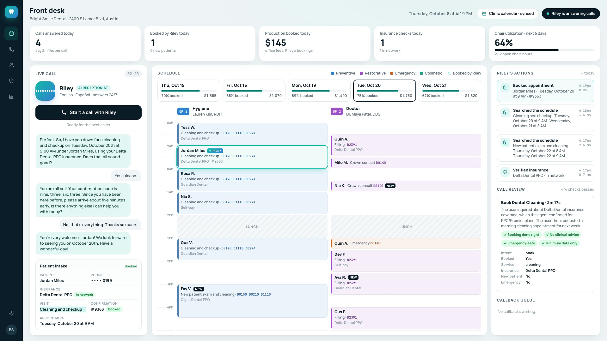
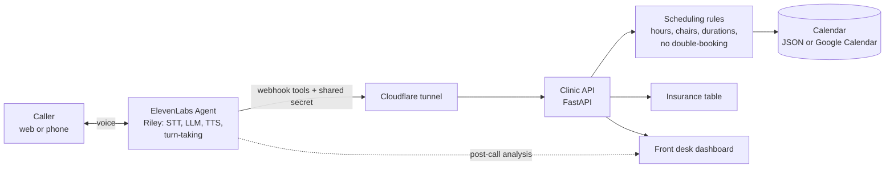

# Riley: an AI voice receptionist for dental clinics

Patients call, ask about their insurance and book a cleaning by voice. The booking lands on the clinic's schedule while they're still on the line, and the front desk watches it happen on a dashboard built the way dental offices actually work: two operatories, ADA procedure codes, new-patient flags, and production booked.

> **Demo build.** A portfolio project with a fictional clinic, Bright Smile Dental in Austin, Texas, and fictional patients. It is not client work. The agent, the tools and the test results are real.



▶️ **[Watch the 84-second video](media/riley-demo.mp4)**: a real call to the live agent, cut into a short walkthrough.

## What it does

| Caller says | Riley does |
|---|---|
| "Do you take Delta Dental?" | Checks a real network table: yes for the PPO and Premier, and warns that the DeltaCare HMO is out of network |
| "Can I get a cleaning next week, mornings?" | Searches both chairs against the clinic's hours, lunch break, appointment lengths and existing bookings, then offers 2 to 3 real times at least an hour apart |
| "The 9 o'clock, I'm Jordan Miles, 512 555 0199" | Reads the number back, confirms, books, and gives a confirmation code |
| "My face is swelling toward my eye and I have a fever" | Tells them to call 911 or go to the ER now. It doesn't book |
| "I cracked a tooth, it really hurts" | Books the earliest emergency visit, with no diagnosis and no medication advice |
| "I need to move my appointment" | Takes a callback request for the front desk |
| "Hola, ¿hablan español?" | Switches to Spanish |

The dashboard shows the call as it happens: the live transcript, a patient intake card that fills itself in, every lookup and booking Riley makes (with timing), and the new appointment landing on the schedule. When the call ends, ElevenLabs scores it against four clinic rules and the review appears beside it.

## How it works



Four webhook tools: `check_availability`, `book_appointment`, `verify_insurance` and `request_callback`. The agent also has ElevenLabs' built-in `end_call` and `language_detection`.

## Why it's different

- **The LLM never decides what's true.** Opening hours, appointment lengths, which chair, double-booking and insurance network status are all enforced in tested Python code. The agent can only offer slots the API returned, and a booking only counts if the API confirms it.
- **The agent is defined in code.** The prompt, voice, turn-taking, tools, knowledge base, post-call data extraction, evaluation criteria and guardrails all live in this repo (`src/receptionist/agent_config.py`, `agent/prompt.md`). `scripts/sync_agent.py` creates or updates the agent and its tools idempotently.
- **It's tested like software.** There are 13 scripted caller scenarios (insurance traps, emergencies, prompt injection, Spanish, requests for personal data) run on ElevenLabs Agent Testing against the real tools, plus 52 unit tests.
- **It's built for a dental practice, not a generic one.** Two operatories (hygiene and doctor), CDT codes, new-patient exams that are 90 minutes instead of 60, a 2-hour minimum lead time, holidays, and the Delta PPO vs DeltaCare HMO trap.
- **Safety and privacy are designed in.** It collects only name, phone, carrier and reason, never date of birth, SSN or member ID. Full phone numbers stay out of logs. It tells callers honestly that it's an AI. Prompt-injection and focus guardrails are on, webhook calls carry a secret header, and the clinic API rejects calls without it.
- **It's tuned for voice.** Spoken-friendly dates and phone read-backs, ElevenLabs text normalisation, patient spelling mode for phone numbers, speculative turn-taking, a soft "One moment." filler, a typing sound during lookups, and no interruptions while a booking is being written.

## Real test-run numbers

| Metric | Result |
|---|---|
| Simulated caller scenarios passed (first run) | **12 of 13**. The one failure was a real double-booking race between two parallel callers, which the API correctly blocked |
| Tool round trip, ElevenLabs → clinic API → back (median / p90) | **0.37 s / 0.63 s** over 21 calls |
| Recorded call: caller stops talking → Riley's first audio | **1.06–1.42 s** on plain turns, **2.3–3.0 s** when Riley calls a tool first (median 1.42 s over 12 turns) |
| Recorded call: ElevenLabs post-call evaluation | **4 of 4** clinic rules passed |
| Recorded call: LLM cost | **$0.046** for a 137 s call |
| Unit tests | 52 passing, under 1 s |

Details, dates and caveats: [media/test-run-metrics.md](media/test-run-metrics.md).

## Quick start (no accounts, no keys)

```bash
python3 -m venv .venv && source .venv/bin/activate
pip install -e ".[dev]"
pytest -q                                   # 52 tests
python scripts/seed_calendar.py             # a realistic, mostly-booked 2-week schedule
uvicorn receptionist.server:app --app-dir src --port 8000
```

Open http://localhost:8000. In a second terminal, replay a scripted call through the same tool endpoints the agent uses, and watch the dashboard fill:

```bash
python scripts/replay_call.py
```

## Real mode (live voice agent)

You need an ElevenLabs account (the Starter plan is enough) and `cloudflared`, which is free and needs no Cloudflare account for quick tunnels.

1. **ElevenLabs API key:** elevenlabs.io → Developers → API Keys → Create key. Paste it into a `.env` file in the project root (it's gitignored):
   ```
   ELEVENLABS_API_KEY=your-key
   ```
2. **Start everything and create the agent:**
   ```bash
   scripts/dev.sh --full
   ```
   This starts the API and a tunnel, generates `TOOL_SECRET` into `.env`, stores it as an ElevenLabs workspace secret, uploads the knowledge base, and creates the 4 tools and the agent. Later runs (`scripts/dev.sh`) only re-point the tools at the new tunnel URL.
3. Open http://localhost:8000 and click **Start a call with Riley**.
4. Optional: `python scripts/run_evals.py` runs the 13 caller scenarios. Results go to `media/evals/`.
5. Optional: `python scripts/test_caller.py --out media/call` places a call with a synthetic caller voice and saves a synced recording; `python scripts/call_metrics.py` prints that call's latency numbers from ElevenLabs. `scripts/record_dashboard.py` records the dashboard in headless Chrome at the same time.

**Phone number:** in the ElevenLabs dashboard, import a Twilio or SIP number and assign it to the agent. The tools are the same webhooks. This wasn't part of the recorded test run.

**Google Calendar:** set `CALENDAR_BACKEND=google`, `GOOGLE_SERVICE_ACCOUNT_FILE` and `GOOGLE_CALENDAR_ID` in `.env`, then share the calendar with the service account ("Make changes to events"). The adapter is unit-tested but wasn't used in the recorded run.

## Costs

| Item | Cost |
|---|---|
| ElevenLabs Starter plan | $6/month: 75 agent call minutes included, then $0.08/min. LLM usage comes out of plan credits |
| One eval run (13 scenarios) | About 4,300 credits |
| Cloudflare quick tunnel | Free |
| Clinic API, dashboard, calendar | Free (runs locally) |

Prices checked on 2026-10-09 at [elevenlabs.io/pricing](https://elevenlabs.io/pricing) and [elevenlabs.io/pricing/agents](https://elevenlabs.io/pricing/agents).

## Project layout

```
agent/
  prompt.md            system prompt (Personality, Environment, Tone, Goal, Guardrails, Tools, Error handling)
  evals.json           13 simulated-caller scenarios with success conditions
src/receptionist/
  clinic.py            clinic facts: hours, chairs, services, CDT codes, fees, insurance table
  scheduling.py        slot search and booking rules
  insurance.py         network lookup (PPO vs HMO aware)
  agent_config.py      the ElevenLabs agent, tools, analysis and guardrails as code
  knowledge.py         knowledge base rendered from clinic.py
  server.py            webhook tools + dashboard API
  insights.py          dashboard numbers (production, utilization, bookings)
  calls.py             call history and post-call reviews from ElevenLabs
  scrub.py             strips account ids and emails before API payloads are saved
  calendars/           JSON and Google Calendar backends
scripts/
  dev.sh               API + tunnel + tool sync
  sync_agent.py        create or update the agent from code
  run_evals.py         run the eval suite on ElevenLabs Agent Testing
  test_caller.py       real call with a synthetic caller voice (websocket), mirrored on the dashboard
  call_metrics.py      a call's per-turn latency and evaluation results from ElevenLabs
  record_dashboard.py  record the dashboard with headless Chrome (DevTools screencast)
  seed_calendar.py     realistic busy schedule
  replay_call.py       mock-mode scripted call
web/                   front desk dashboard (plain HTML, CSS, JS)
tests/                 52 pytest tests
media/                 metrics, eval results, the recorded call, share images
```

## Compliance notes

- **HIPAA:** a real deployment handles protected health information. It needs a Business Associate Agreement with every vendor that touches call data. ElevenLabs signs BAAs for Agents only on the Enterprise tier, and only for agents in Zero Retention Mode, which turns off stored transcripts, audio and tool logs. Under that mode only BAA-covered LLMs are available; the docs list Gemini 3.5 Flash, the model this agent already uses ([ElevenLabs HIPAA docs](https://elevenlabs.io/docs/eleven-agents/legal/hipaa)). The clinic API should run on a server rather than a laptop tunnel. This build uses fictional data only.
- **AI disclosure:** Riley says it's an AI when asked. Some US states require disclosure up front, which is a one-line change to the first message.
- **Call recording:** in this build, recording is on (90-day retention) so calls can be reviewed and scored. A HIPAA deployment would use Zero Retention instead. Check your state's call-recording consent rules before going live.
- Riley gives no clinical advice and sends medical emergencies to 911 or the ER.

## License

MIT
